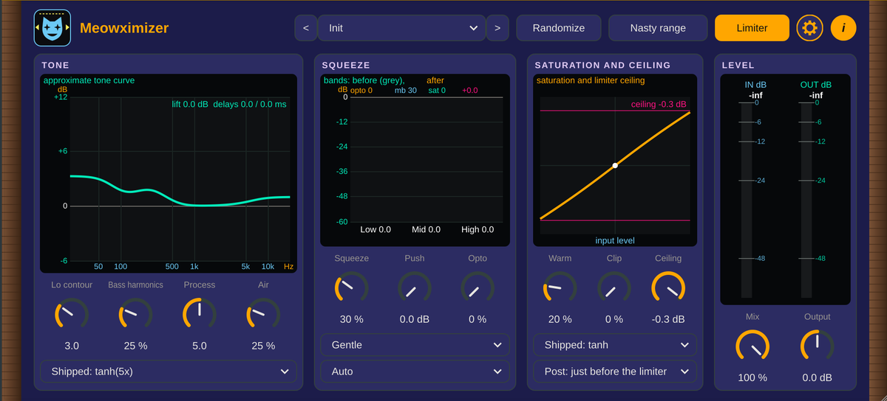

# Meowximizer 🐈

Free, open source sonic enhancer, bass enhancer and exciter for Linux (VST3 and standalone). Three phase-aligned bands: low contour and bass harmonics, mid and high time offsets and dynamic lift, air exciter, optional OTT-style squeeze, light saturation and an output limiter.

**Manual:** [PDF with interface tour, opens in the browser](https://github.com/SpeakingColors/Meowximizer/blob/main/docs/Meowximizer-manual.pdf)

 Screenshot of the real plugin window (Linux standalone build).

## Status
Early scaffold. It builds in CI (Linux VST3 and standalone) but has not been tuned by ear yet.

  

☕ Free and open source, made by one person. If it helps your music, a coffee on [Ko-fi](https://ko-fi.com/studio87) keeps it coming. 💜

## Docs
- [Roadmap](ROADMAP.md)

## Build
CMake 3.22+, a C++17 compiler and the usual JUCE Linux libraries. `cmake -B build -DCMAKE_BUILD_TYPE=Release && cmake --build build`. JUCE and the shared cat-ui look are fetched automatically.

## License
AGPL-3.0-or-later, see [LICENSE](LICENSE).

Original design. The idea of lows and mids arriving slightly after the highs is a long-known public concept (sonic maximizers); all numbers here are our own choices. It is not affiliated with BBE and contains nothing from their products.
